<!-- OWNER:AlanSmithDev -->
# shouyin-icepos-v2

> 项目维护者 / Maintained by **AlanSmithDev** · 2916304767@qq.com

---

# ICEPOS收银系统 V2.COURAGE Electron+Vue开源版

#### 介绍
ICEPOS桌面版收银系统V2跨越版(勇气.COURAGE)！软件底层框架使用Electron,前端框架Vue3,UI组件包括Vant4、Element Plus 2 等。系统底层逻辑源码基本开源，可用于学习和商业使用！开源协议依然遵循Apache2.0! 当前版本属跨平台开发，基于TypeScript或Javascript脚步开发各类组件和应用，从技术上来讲，已将桌面版本的收银软件开发难度降到最低点！

#### 软件架构
1.Electron桌面应用程序框架

2.VUE前端框架

3.Vant移动端组件库

4.Element Plus组件库

5.SQLite数据库

6.Axios网络请求

7.本地日志

8.打印机&硬件控制

#### 开源版测试和运行过程
1.下载node.js版本 v22.22.3 稳定版（双击安装,亲测版本可用）

[https://nodejs.org/zh-cn/download](https://nodejs.org/zh-cn/download)

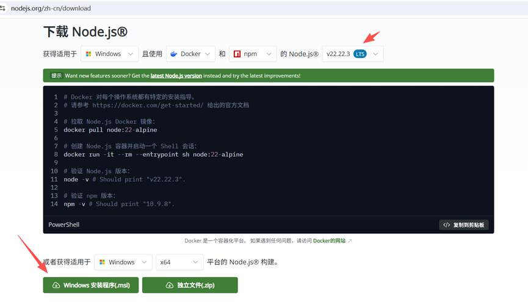

2.打开命令提示符 win（徽标键）+ r 键
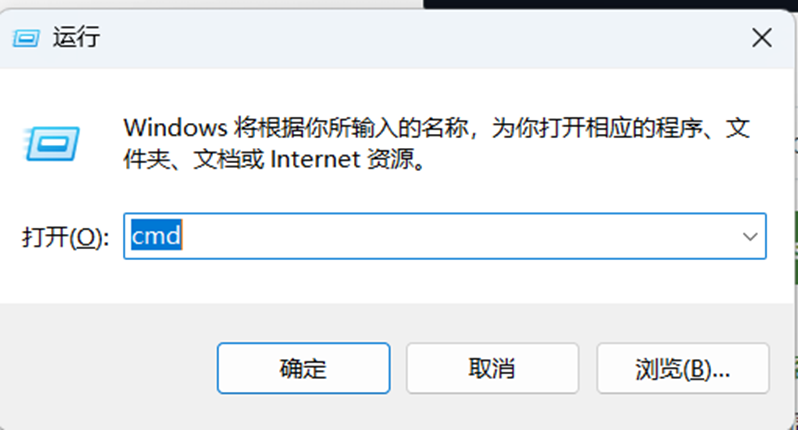

例如: 代码下载到本地 D:\wamp\www\iceposv2 目录下
则按照下图,输入命令: 
> D:   
> cd wamp/www/iceposv2   

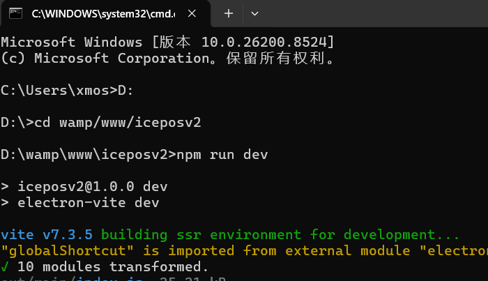

node_modules 文件夹内有37个分包压缩的项目所需插件，任意一个压缩包右键解压即可！解压后将node_modules 文件夹全部复制到项目目录 iceposv2下即可，覆盖node_modules

假如没有 node_modules 插件文件夹，则需要输入命令安装（等待时间可能要十几分钟）:

npm install

测试运行: npm run dev

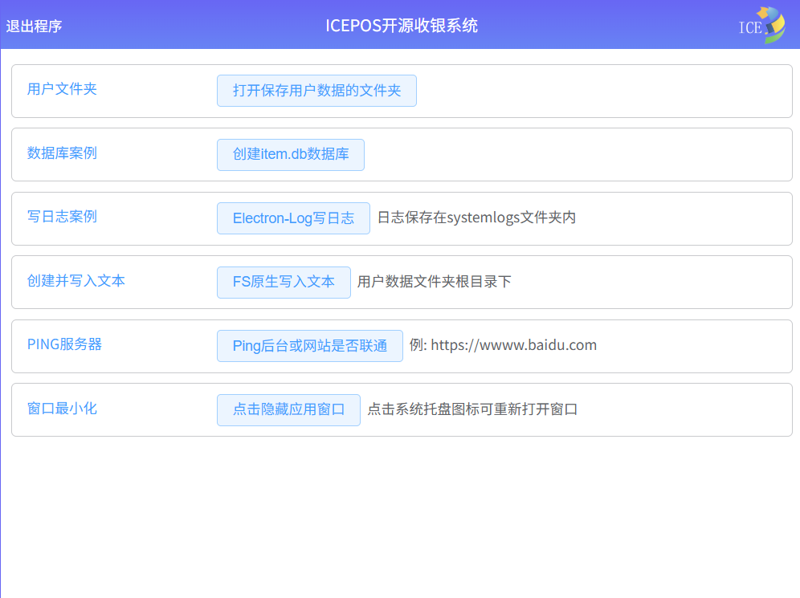

#### 功能截图

登录界面

    

        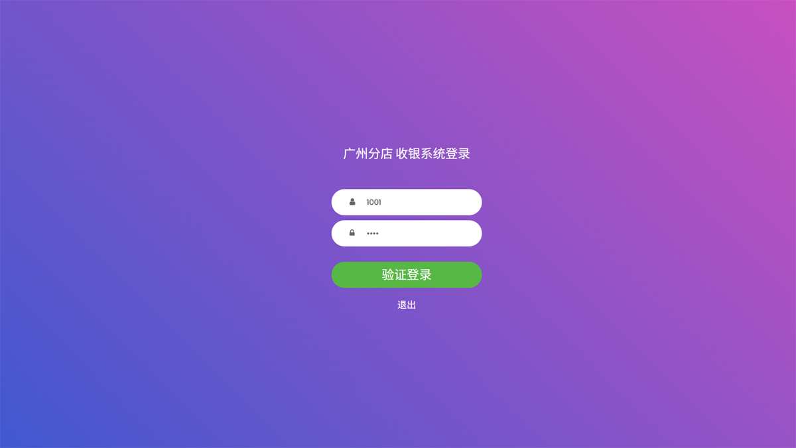
    

收银主界面

    

        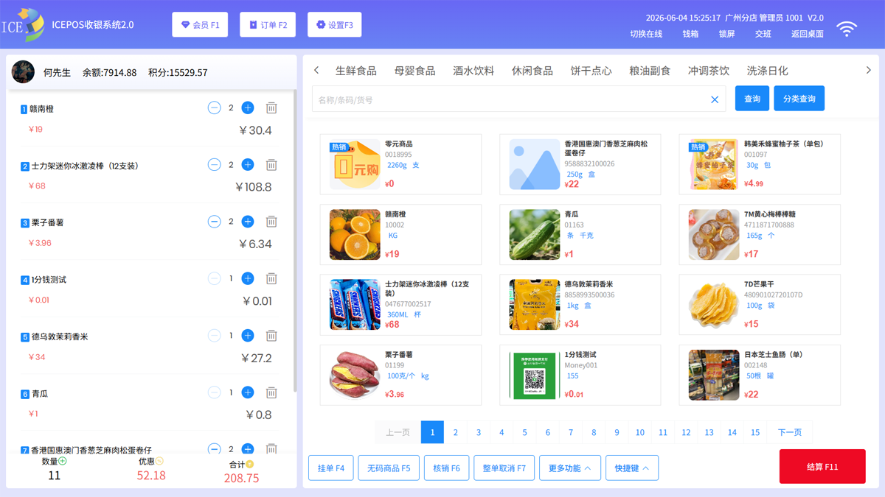
    

客户屏幕

    

        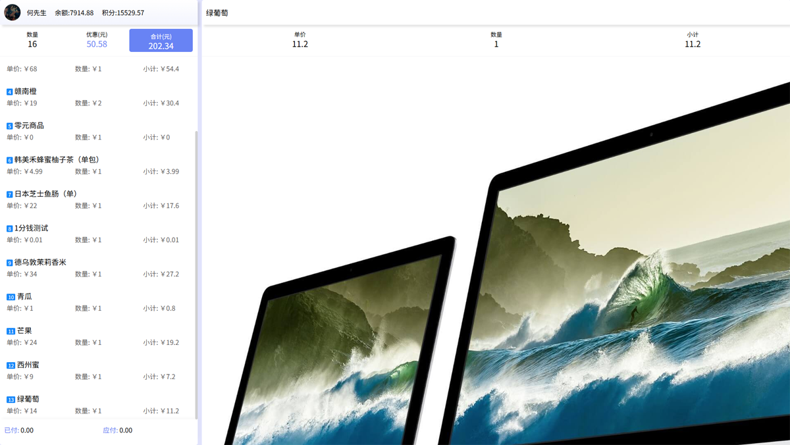
    

营业员锁屏

    

        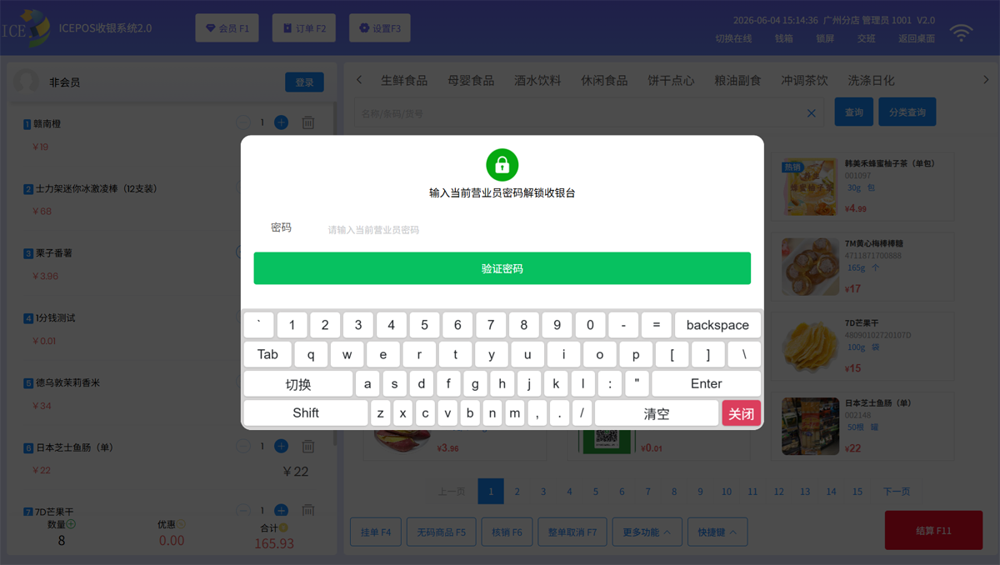
    

    

        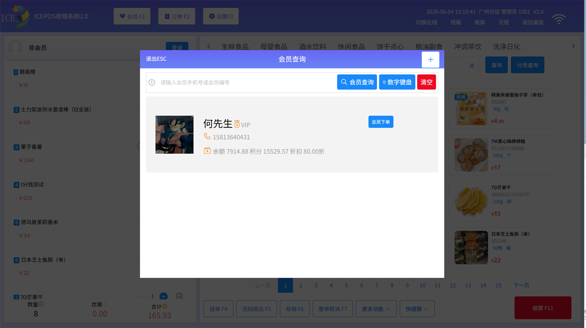
    

    

        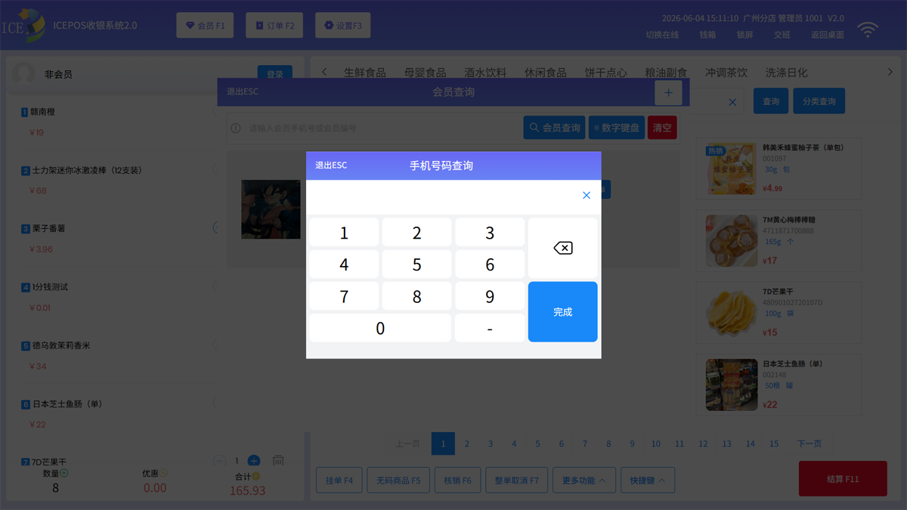
    

    

        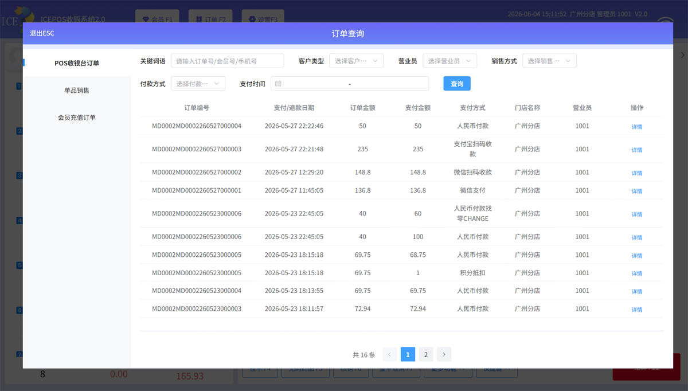
    

    

        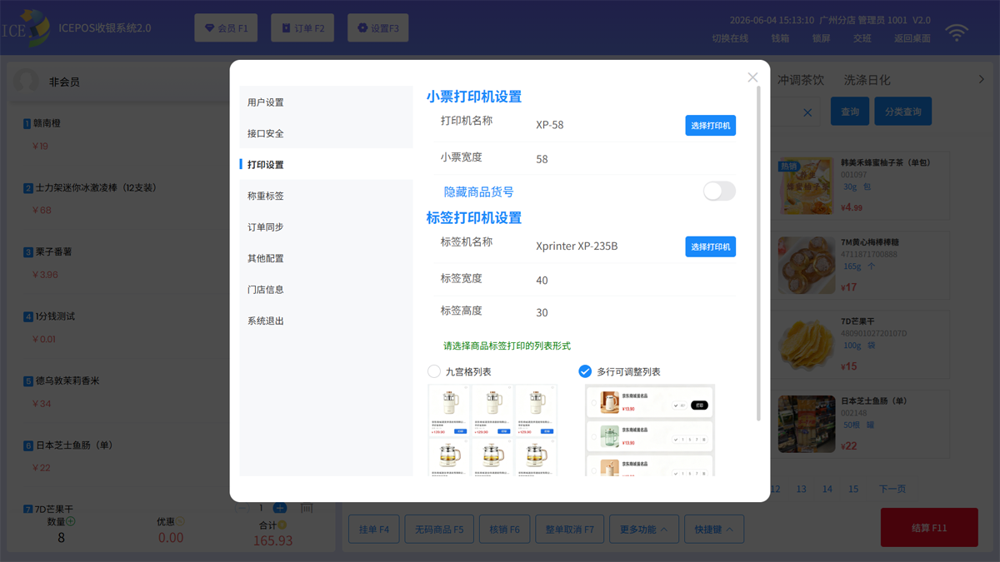
    

    

        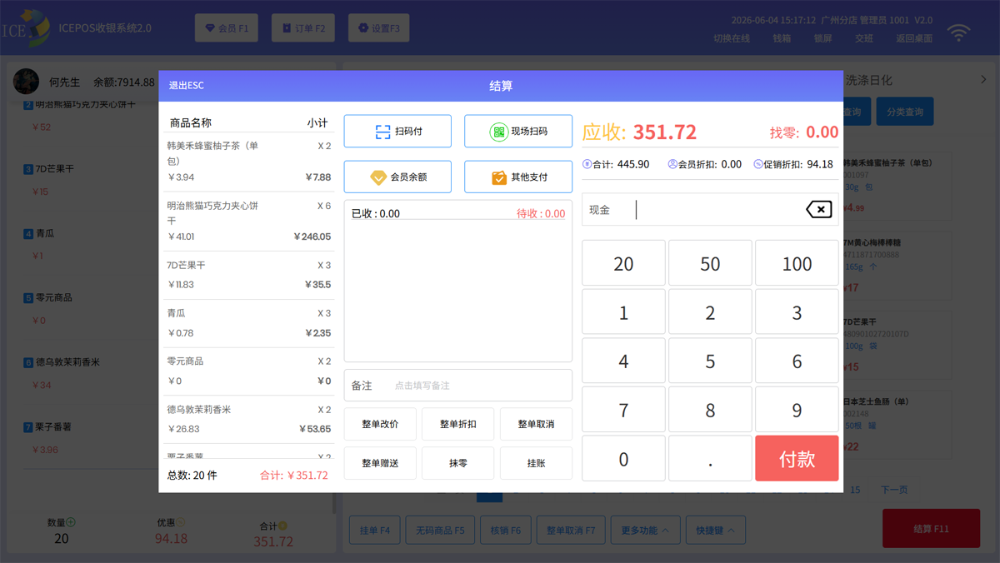
    

    

        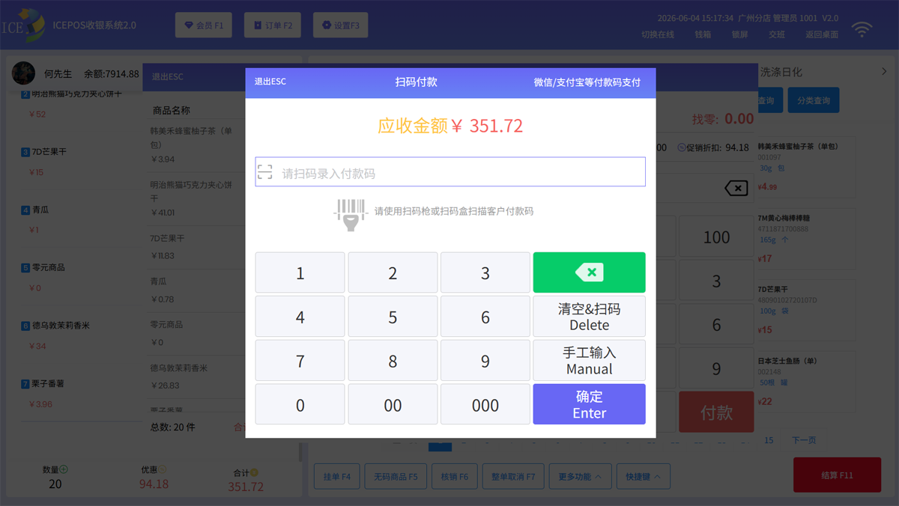
    

    

        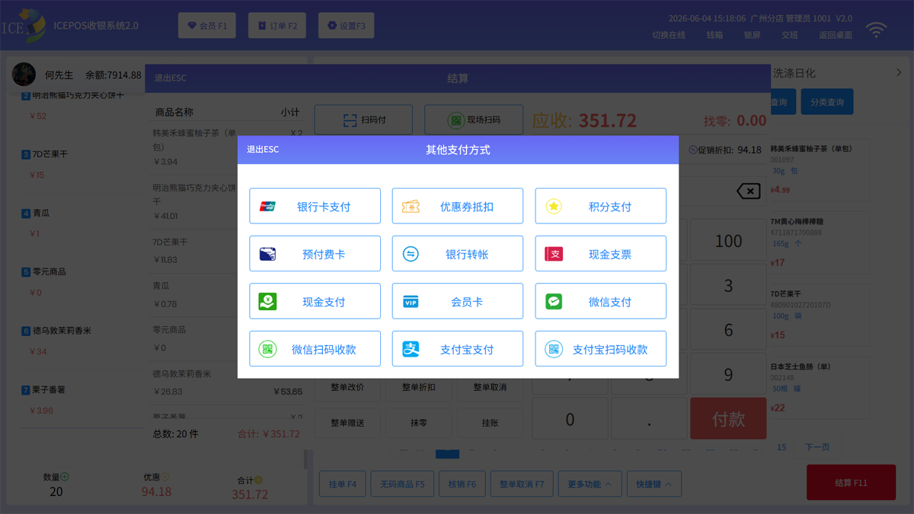
    

    

        
    

    

        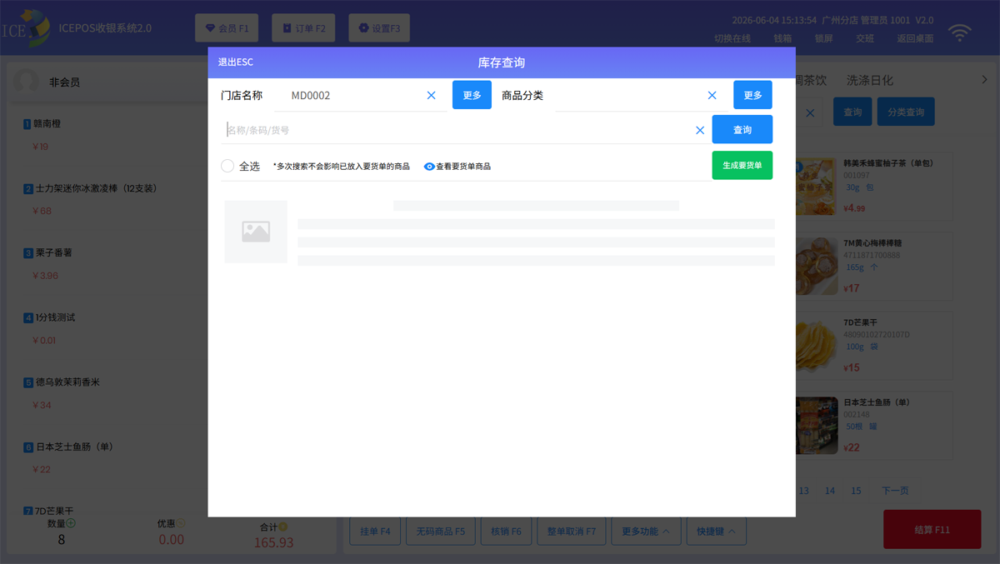
    

    

        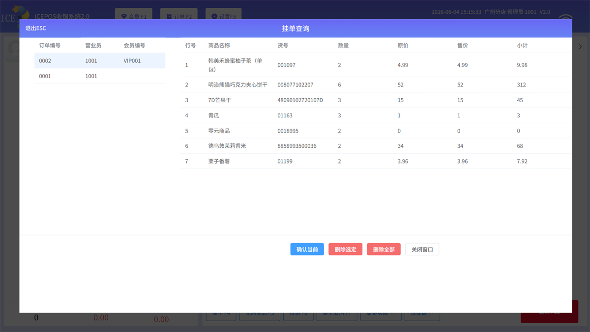
    

    

        
    

#### 文档参考
1. Electron https://www.electronjs.org/zh

2.Vue https://cn.vuejs.org

3.Vant https://vant.pro

4.Element Plus  https://element-plus.org

